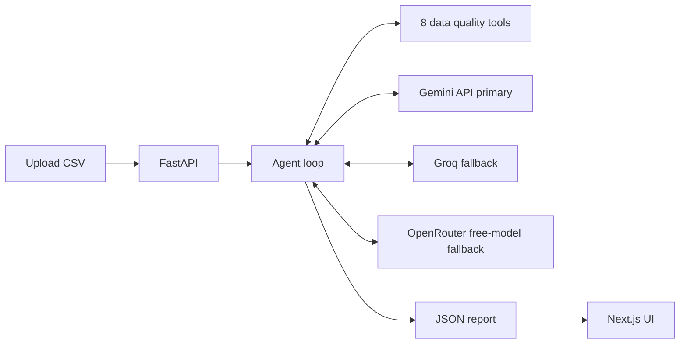

# Data Quality AI Agent

Upload a CSV to find data quality issues such as missing values, duplicates, outliers, and inconsistent types.
The FastAPI backend runs local analysis tools and returns a score and actionable fixes to the Next.js interface.

## Live demo

- **Frontend:** https://your-vercel-app.vercel.app
- **Backend:** https://your-render-service.onrender.com

The free Render backend may take about **50 seconds** to wake up on its first request. Please wait for the analysis to finish.

## Architecture



## Data quality tools

- **check_nulls** — Counts null values and calculates their percentage per affected column.
- **find_duplicates** — Counts duplicate rows and returns a few small examples.
- **detect_outliers** — Finds numeric outliers with the IQR method.
- **check_types** — Identifies mixed types and text values in numeric columns.
- **check_value_rules** — Finds negative values in relevant columns and invalid dates.
- **check_placeholders** — Counts placeholder values such as `?`, `unknown`, `N/A`, and `null`.
- **check_text_consistency** — Finds leading or trailing spaces and mixed-case variants.
- **check_column_health** — Finds constant columns, columns over 50% null, and high-cardinality text columns.

## Tech stack

- **Frontend:** Next.js App Router, React, TypeScript, Tailwind CSS
- **Backend:** Python, FastAPI, pandas, SlowAPI
- **LLM:** Gemini API with function calling, followed by Groq and OpenRouter fallbacks

## Run locally

### Backend

In PowerShell, from the repository root:

```powershell
cd dq-agent-backend
py -m venv venv
.\venv\Scripts\Activate.ps1
python -m pip install --upgrade pip
pip install -r requirements.txt
Copy-Item .env.example .env
```

Add `GEMINI_API_KEY` to `dq-agent-backend/.env`. Add `GROQ_API_KEY` and/or `OPENROUTER_API_KEY` for fallbacks, then start the API:

```powershell
uvicorn main:app --reload
```

The API runs at `http://localhost:8000`; interactive docs are at `http://localhost:8000/docs`.

### Frontend

In a second terminal, from the repository root:

```powershell
cd dq-agent-frontend
npm install
npm run dev
```

Open `http://localhost:3000`. The page defaults to the local API at `http://localhost:8000`. To use another backend, set `NEXT_PUBLIC_API_URL` in `dq-agent-frontend/.env.local` and restart the frontend.

## Evaluation

Run the evaluator from `dq-agent-backend` with `GEMINI_API_KEY` configured:

```powershell
python evaluate.py
```

It runs the agent three times on `data/dirty.csv`, compares reported column names and problem keywords with `data/injected_log.json`, then shows detections, missed issue types, and tools used per run. The agent tries Gemini first, then Groq, then OpenRouter if earlier providers fail.

**Evaluation result:** Detected X of Y injected issue types

## Limits and data handling

- CSV uploads are limited to **5 MB** and **50,000 rows**.
- `/analyze` and `/sample` are limited to **5 requests per minute per IP**.
- Uploaded CSV data is read for analysis and is not retained by the application after the request.
- The `/sample` endpoint reads the bundled `dq-agent-backend/data/dirty.csv` file.
